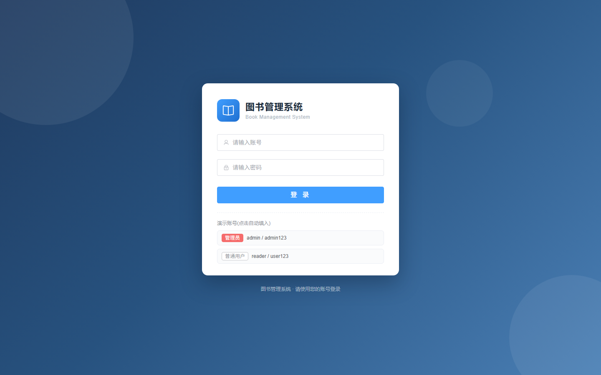
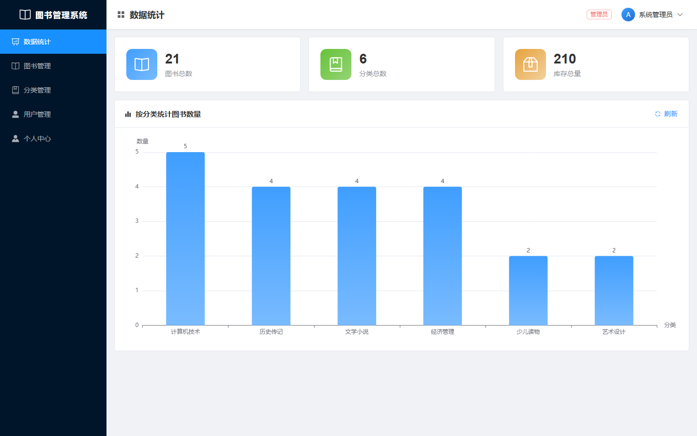
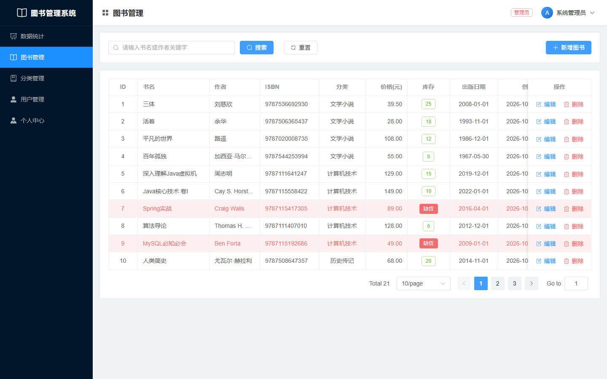
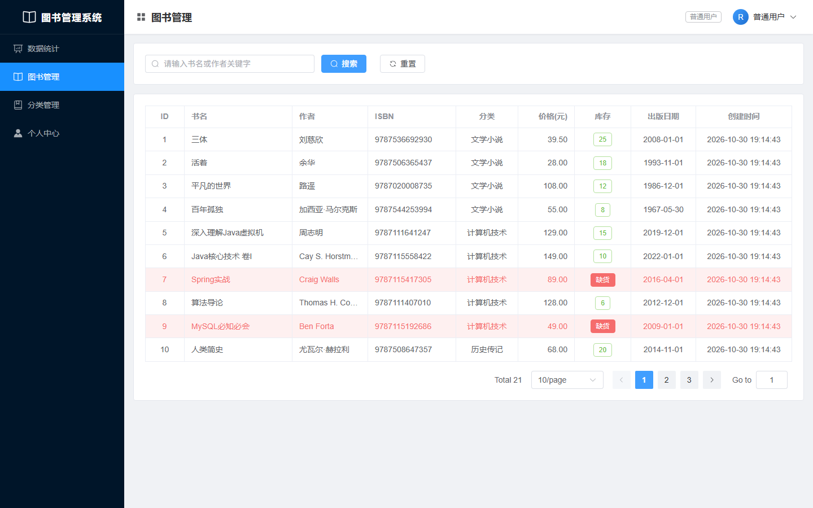
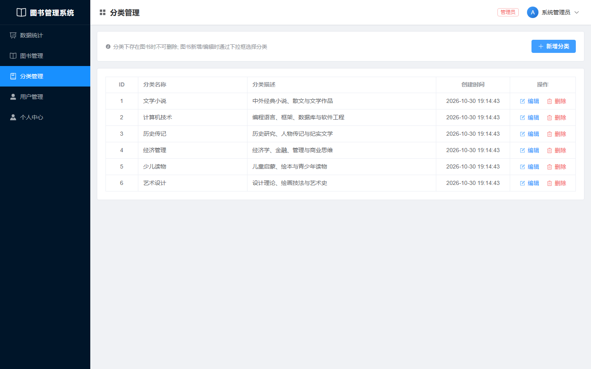
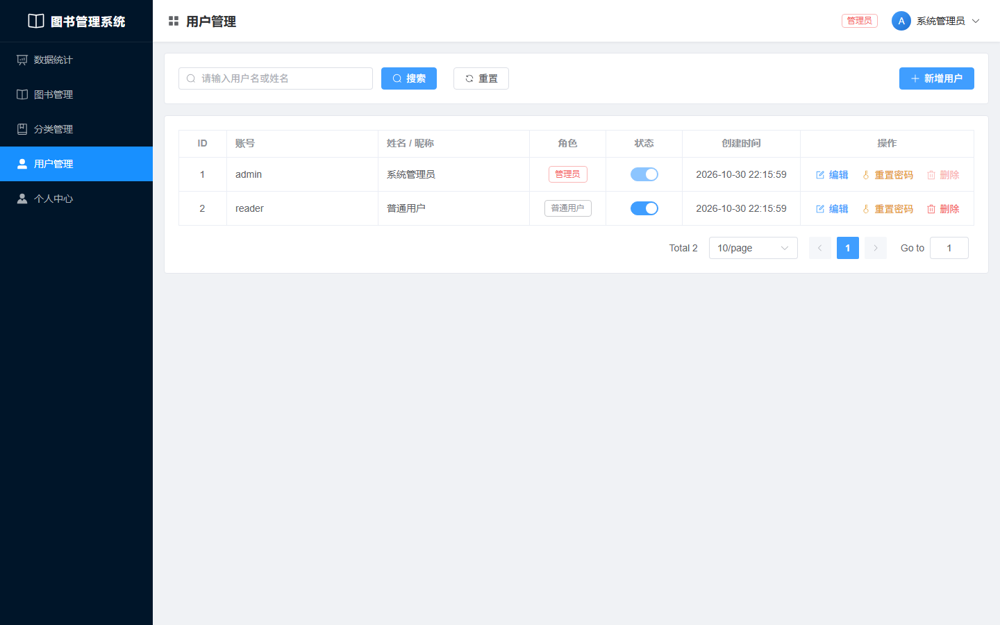

<div align="center">

# 图书管理系统

**Spring Boot 3 + Vue 3 前后端分离示例项目，内置登录认证与「管理员 / 普通用户」两级权限体系**


[项目简介](#项目简介) · [功能特性](#功能特性) · [界面预览](#界面预览) · [快速开始](#快速开始) · [权限设计](#登录与权限设计) · [接口清单](#接口清单) · [常见问题](#常见问题)

</div>

---

## 项目简介

一个完整的图书管理练手项目：后端负责数据与鉴权，前端负责界面与交互，前后端通过 REST 接口通信。

项目在基础的图书 / 分类增删改查之上，补齐了真实业务常见的三件事：

- **独立登录页**：账号密码认证，登录后签发令牌，无需引入 Spring Security / JWT 依赖；
- **两级角色**：管理员与普通用户，权限差异由后端统一下发，前端只负责渲染；
- **全链路鉴权**：接口请求、路由跳转、功能菜单、按钮操作四层都做了控制，越权访问在后端被直接拒绝。

图书、分类的数据结构与原有接口保持兼容，老数据库可以直接升级（只新增用户表，不动业务数据）。

## 功能特性

| 模块 | 功能 | 管理员 | 普通用户 |
| ---- | ---- | :----: | :----: |
| 登录认证 | 独立登录页、令牌签发与校验、退出登录 | ✓ | ✓ |
| 数据统计 | 图书 / 分类 / 库存总量卡片 + 按分类统计柱状图（ECharts） | ✓ | ✓ |
| 图书管理 | 分页查询、书名 / 作者关键字搜索、新增、编辑、删除、缺货标红 | ✓ | 仅查看 |
| 分类管理 | 分类列表、新增、编辑、删除（分类下有图书时禁止删除） | ✓ | 仅查看 |
| 用户管理 | 用户列表、新增、编辑角色与状态、重置密码、删除 | ✓ | ✗ |
| 个人中心 | 查看本人账号与权限、修改密码 | ✓ | ✓ |

## 界面预览

| 登录页 | 数据统计 |
| :---: | :---: |
|  |  |

| 图书管理（管理员，可增删改） | 图书管理（普通用户，仅查看） |
| :---: | :---: |
|  |  |

| 分类管理 | 用户管理（仅管理员可见） |
| :---: | :---: |
|  |  |

> 普通用户登录后左侧菜单只有 4 项（没有「用户管理」），图书 / 分类页面不会出现新增、编辑、删除按钮；即使手动访问 `/users`，也会被路由守卫拦回数据统计页。

## 技术栈

**后端**

| 技术 | 版本 | 说明 |
| ---- | ---- | ---- |
| JDK | 21 | 语言基础 |
| Spring Boot | 3.5.16 | Web / 配置管理 |
| MyBatis-Plus | 3.5.12 | 数据访问、分页插件 |
| MySQL | 8.0 | 数据库 |
| Lombok | - | 简化实体类 |

**前端**

| 技术 | 版本 | 说明 |
| ---- | ---- | ---- |
| Vue | 3.5 | `<script setup>` 组合式 API |
| Vite | 5.4 | 开发服务器与构建 |
| Vue Router | 4.5 | 路由与登录 / 权限守卫 |
| Element Plus | 2.9 | UI 组件 |
| ECharts | 5.6 | 统计图表 |
| Axios | 1.7 | 请求封装、自动携带令牌 |

## 快速开始

### 环境要求

| 工具 | 版本 |
| ---- | ---- |
| JDK | 21 |
| Maven | 3.9+ |
| Node.js | 20+ |
| MySQL | 8.0 |

### 1. 获取代码

```bash
git clone <你的仓库地址>
cd book-management
```

### 2. 初始化数据库

```bash
# Windows cmd
mysql -uroot -p --default-character-set=utf8mb4 < db\schema.sql

# macOS / Linux
mysql -uroot -p --default-character-set=utf8mb4 < db/schema.sql
```

脚本会创建数据库 `book_management`、三张表，并写入 6 个分类和 20 本示例图书（其中 2 本库存为 0，用于演示「缺货标红」）。

> **已有数据库？** 只需额外执行一次 `db/upgrade_auth.sql`（只新增 `t_user` 表，不改动原有图书 / 分类数据）。

### 3. 修改数据库配置

编辑 `backend/src/main/resources/application.yml`，把账号密码改成你本机 MySQL 的配置：

```yaml
spring:
  datasource:
    url: jdbc:mysql://localhost:3306/book_management?...
    username: 'root'
    password: '你的 MySQL 密码'
```

> 提交到 GitHub 前请务必确认这里是你自己的本地占位密码，**不要把真实密码推到公开仓库**。

### 4. 启动后端（8080）

IDEA：`File -> Open` 打开 `backend` 目录，运行 `BookApplication`。

命令行：

```bash
cd backend
mvn spring-boot:run
```

看到以下日志即启动成功：

```text
Tomcat started on port 8080 (http)
Started BookApplication in x.xxx seconds
```

### 5. 启动前端（5173）

```bash
cd frontend
npm install     # 首次执行
npm run dev
```

浏览器访问 **http://localhost:5173/login**，用 `admin / admin123` 或 `reader / user123` 登录。

> 前端通过 Vite 代理把 `/api` 转发到 `http://localhost:8080`，本地开发无需处理跨域。

### 6. 一键启动（Windows，可选）

根目录提供 PowerShell 脚本，适合演示或验收：

| 文件 | 作用 |
| ---- | ---- |
| `start.bat` | 双击即可：检查数据库 → 启动后端 → 启动前端 → 打开登录页 |
| `setup-db.bat` | 单独初始化数据库：输入 MySQL 账号密码，导入 `db/schema.sql` 并写回 `application.yml` |

脚本会按需执行 `npm install`、用 IDEA 自带的 Maven 打包 jar、缺库时导入 SQL、老库缺 `t_user` 表时自动执行增量脚本，最后用 Edge 无痕窗口打开登录页。关闭弹出的后端 / 前端控制台窗口即可停止服务。

### 默认账号

| 账号 | 密码 | 角色 | 权限范围 |
| ---- | ---- | ---- | ---- |
| `admin` | `admin123` | 管理员 | 全部菜单 + 增删改操作 + 用户管理 |
| `reader` | `user123` | 普通用户 | 数据统计、图书、分类（只读）、个人中心 |

账号在后端首次启动且 `t_user` 表为空时自动创建，不会覆盖已有用户。

## 登录与权限设计

### 认证流程

1. `POST /api/auth/login` 校验账号密码，成功后返回 `{ token, user }`；
2. 令牌使用 **HmacSHA256 签名**（`base64Url(payload).base64Url(signature)`，payload 含用户 ID、角色、过期时间），默认有效期 12 小时，可在 `application.yml` 的 `app.auth.expire-minutes` 调整；
3. 前端把令牌存在 `localStorage`（键名 `bm_token`），axios 拦截器为每个请求加上 `Authorization: Bearer <token>`；
4. 后端 `AuthInterceptor` 拦截 `/api/**`（登录接口除外），校验签名、过期时间、账号是否存在且启用，并把当前用户写入 `AuthContext`（ThreadLocal）；
5. 令牌无效 / 过期 / 账号被禁用返回 **401**，前端清理登录态并跳回登录页；权限不足返回 **403**。

刷新页面时前端会调用 `GET /api/auth/me` 恢复用户、权限与菜单；未登录访问任意页面都会跳转到登录页并带上原目标地址。

### 角色与权限矩阵

| 权限编码 | 说明 | 管理员 | 普通用户 |
| -------- | ---- | :----: | :----: |
| `stats:view` | 数据统计 | ✓ | ✓ |
| `book:view` | 查看图书 | ✓ | ✓ |
| `book:add` | 新增图书 | ✓ | ✗ |
| `book:edit` | 编辑图书 | ✓ | ✗ |
| `book:delete` | 删除图书 | ✓ | ✗ |
| `category:view` | 查看分类 | ✓ | ✓ |
| `category:add` | 新增分类 | ✓ | ✗ |
| `category:edit` | 编辑分类 | ✓ | ✗ |
| `category:delete` | 删除分类 | ✓ | ✗ |
| `user:manage` | 用户管理 | ✓ | ✗ |
| `profile:view` | 个人中心 | ✓ | ✓ |

角色与权限的映射集中配置在 `backend/src/main/java/com/example/book/auth/RolePermissionRegistry.java`，新增角色或调整权限只需改这一处。

### 四层权限控制

| 层级 | 实现位置 | 说明 |
| ---- | ---- | ---- |
| 接口请求 | `AuthInterceptor` + `@RequirePermission` | 需要权限的接口标注权限编码，越权请求直接 403，不依赖前端隐藏按钮 |
| 路由跳转 | `frontend/src/router/index.js` | 未登录跳登录页；`meta.permission` 不满足时提示并跳转到有权限的页面 |
| 功能菜单 | 登录 / `/api/auth/me` 下发的 `menus` | 后端按权限过滤菜单，普通用户看不到「用户管理」 |
| 按钮操作 | `frontend/src/directives/permission.js` | `v-permission` 指令把无权限的按钮从 DOM 中移除，避免「看得见点不了」 |

### 安全细节

- 密码使用加盐 SHA-256（1000 次迭代）存储，数据库中不保存明文，比较时使用常量时间方法；
- 登录失败统一提示「用户名或密码错误」，不暴露账号是否存在；
- 禁止删除 / 禁用当前登录账号，禁止把最后一名启用的管理员降级或删除；
- 修改密码需要校验原密码；管理员重置他人密码后，旧令牌仍会在下次接口调用时被校验。

## 项目结构

```text
book-management/
├── backend/                          # Spring Boot 后端
│   ├── pom.xml
│   └── src/main/
│       ├── java/com/example/book/
│       │   ├── BookApplication.java        # 启动类
│       │   ├── auth/                       # 令牌、密码哈希、权限注册表、拦截器、权限注解
│       │   ├── common/                     # Result 统一返回、业务异常、全局异常处理
│       │   ├── config/                     # 跨域、MyBatis-Plus 分页、拦截器注册、默认账号初始化
│       │   ├── controller/                 # Auth / User / Book / Category / Stats
│       │   ├── dto/                        # 登录、用户保存、改密等请求对象
│       │   ├── entity/                     # Book / Category / User
│       │   ├── mapper/                     # MyBatis-Plus Mapper
│       │   ├── service/ + service/impl/    # 业务层
│       │   └── vo/                         # 统计 / 用户 / 菜单 VO
│       └── resources/application.yml       # 端口、数据源、令牌配置
├── frontend/                         # Vue 3 前端
│   ├── vite.config.js                # /api 代理到 8080
│   └── src/
│       ├── api/                      # axios 封装（自动带令牌）+ 各模块接口
│       ├── directives/               # v-permission 按钮级权限指令
│       ├── layout/MainLayout.vue     # 左侧权限菜单 + 顶部用户信息 + 内容区
│       ├── router/                   # 路由与登录 / 权限守卫
│       ├── store/auth.js             # 登录态、权限、菜单
│       ├── utils/session.js          # 令牌本地存储
│       └── views/                    # Login / Dashboard / BookManage / CategoryManage / UserManage / Profile
├── db/
│   ├── schema.sql                    # 全量初始化（含 t_user 表与示例数据）
│   └── upgrade_auth.sql              # 老库增量升级（仅新增 t_user 表）
├── docs/screenshots/                 # README 截图
├── start.bat / start.ps1             # Windows 一键启动
├── setup-db.bat / setup-db.ps1       # 数据库初始化脚本
└── README.md
```

## 数据库设计

| 表 | 说明 | 主要字段 |
| ---- | ---- | ---- |
| `t_book` | 图书 | `id`、`name`、`author`、`isbn`、`category_id`、`price`、`stock`、`publish_date`、`create_time`、`update_time` |
| `t_category` | 图书分类 | `id`、`name`、`description`、`create_time`、`update_time` |
| `t_user` | 用户 | `id`、`username`、`password`、`real_name`、`role`、`status`、`create_time`、`update_time` |

- `t_user.role`：`ADMIN` / `USER`；`t_user.status`：`1` 启用、`0` 禁用；
- `t_user.username` 唯一索引，密码字段为 `sha256$迭代次数$盐$哈希` 格式。

## 接口清单

统一返回 `Result{ code, message, data }`。

| 方法 | 路径 | 说明 | 权限 |
| ---- | ---- | ---- | ---- |
| POST | `/api/auth/login` | 登录，返回令牌 + 用户权限 + 菜单 | 无需登录 |
| GET | `/api/auth/me` | 当前登录用户信息 | 登录 |
| PUT | `/api/auth/password` | 修改本人密码 | 登录 |
| POST | `/api/auth/logout` | 退出登录（前端清理令牌） | 登录 |
| GET | `/api/user/page?current=1&size=10&keyword=xx` | 用户分页 + 账号 / 姓名搜索 | `user:manage` |
| POST | `/api/user` | 新增用户 | `user:manage` |
| PUT | `/api/user` | 编辑用户（姓名 / 角色 / 状态 / 可选密码） | `user:manage` |
| PUT | `/api/user/{id}/password` | 重置他人密码 | `user:manage` |
| DELETE | `/api/user/{id}` | 删除用户 | `user:manage` |
| GET | `/api/book/page?current=1&size=10&keyword=xx` | 图书分页 + 书名 / 作者搜索 | `book:view` |
| POST | `/api/book` | 新增图书 | `book:add` |
| PUT | `/api/book` | 编辑图书 | `book:edit` |
| DELETE | `/api/book/{id}` | 删除图书 | `book:delete` |
| GET | `/api/category/list` | 分类列表 | `category:view` |
| POST | `/api/category` | 新增分类 | `category:add` |
| PUT | `/api/category` | 编辑分类 | `category:edit` |
| DELETE | `/api/category/{id}` | 删除分类（分类下有图书时返回业务错误） | `category:delete` |
| GET | `/api/stats/summary` | 图书 / 分类 / 库存总数 | `stats:view` |
| GET | `/api/stats/category-count` | 按分类统计图书数量 | `stats:view` |

## 常见问题

**1. 后端启动报数据库连接失败？**
优先执行 `setup-db.bat` 重新输入 MySQL 账号密码（会自动导入 `db/schema.sql` 并写回配置），或手动执行 SQL 后修改 `application.yml`。

**2. 前端页面没有数据？**
确认后端 8080 已启动，并在浏览器 F12 的 Network 面板检查 `/api/**` 请求是否被代理到 8080。

**3. 登录提示「用户名或密码错误」？**
确认数据库中存在 `t_user` 表（老库需执行 `db/upgrade_auth.sql`），并且后端已用最新代码重新打包启动；首次启动日志会打印默认账号。

**4. 提示「登录状态已失效」？**
令牌默认 12 小时有效；修改 `app.auth.secret` 或重启后端也会使旧令牌失效，重新登录即可。

**5. 为什么一键启动脚本用无痕窗口？**
在部分装有安全软件的 Windows 机器上，普通 Edge 窗口点击「最小化」后会被系统钩子立即还原（关闭全部扩展仍可复现，与项目代码无关），无痕窗口不受影响。想用普通窗口时，直接访问 `http://localhost:5173` 即可，功能完全一致。

**6. 为什么不用 Spring Boot 4？**
当前 MyBatis-Plus 尚未提供 Spring Boot 4 适配版本，因此项目固定在 **Spring Boot 3.5.16 + mybatis-plus-spring-boot3-starter 3.5.12**。升级主版本前请先确认 MyBatis-Plus 已适配。

**7. 想修改后端端口？**
同时修改 `backend/src/main/resources/application.yml` 的 `server.port` 与 `frontend/vite.config.js` 中 proxy 的 `target`。

## 说明

- 本项目用于学习与演示，示例数据、默认账号均为教学用途；
- 正式环境部署前请修改 `app.auth.secret`、删除或修改默认账号密码，并替换为随机强度足够的密钥；
- 提交到公开仓库时请检查 `application.yml`、日志与本地配置中是否包含真实数据库账号、密码等敏感信息。
